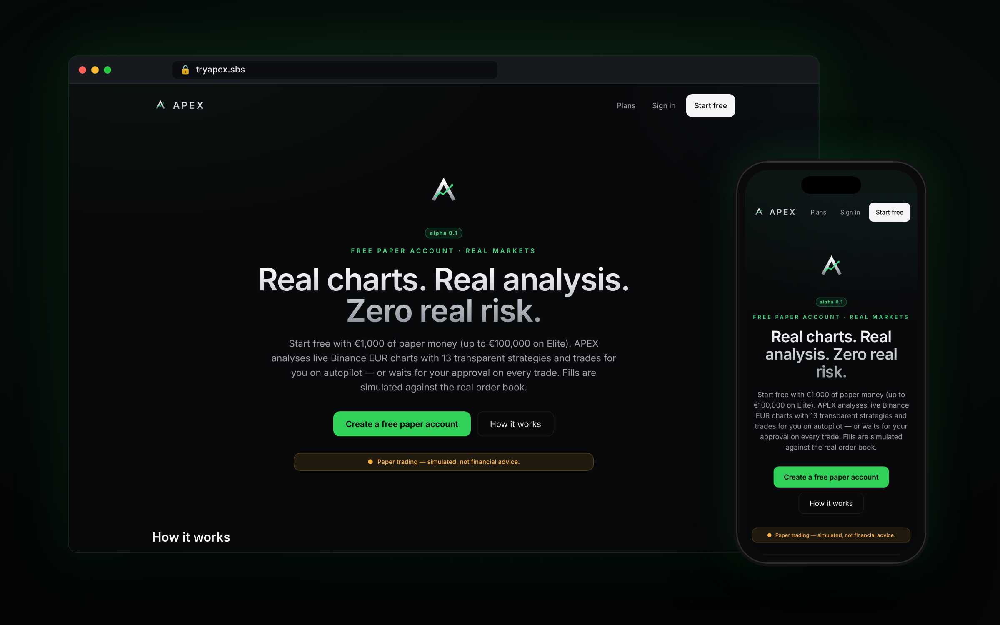
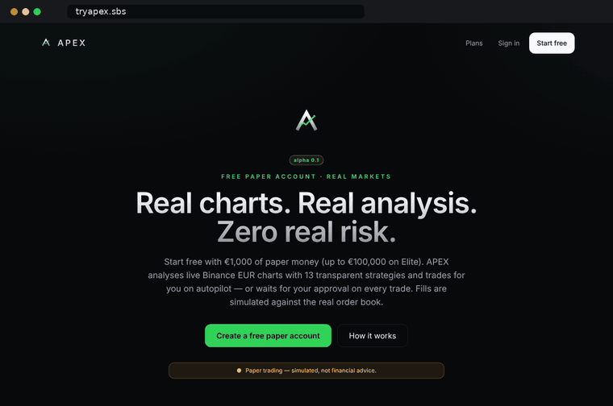
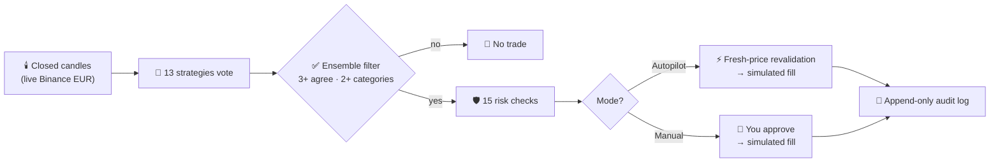
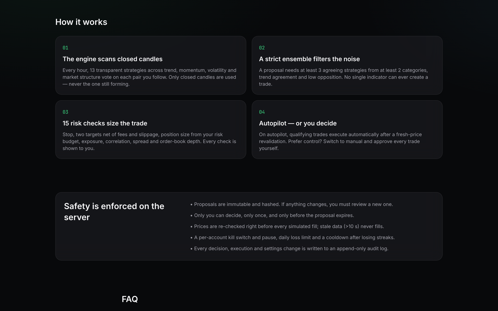
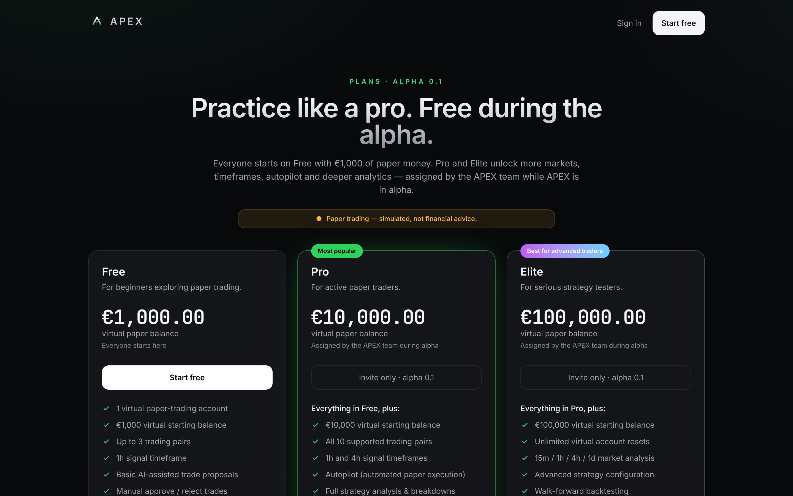
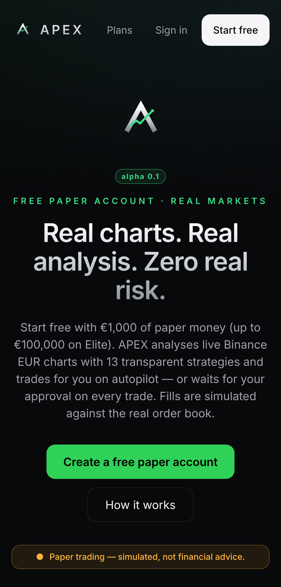

<!-- ═══════════════════════════ HEADER ═══════════════════════════ -->
<p align="center">
  
</p>

<h1 align="center">
  Hey there  I'm Mateliz
</h1>

<p align="center">
  <a href="https://tryapex.sbs">
    
  </a>
</p>

<p align="center">
  <a href="https://tryapex.sbs"></a>
  
  
  <a href="https://github.com/CharleyTheCoder?tab=followers"></a>
</p>


<!-- ═══════════════════════════ APEX SHOWCASE ═══════════════════════════ -->
<h2 align="center">
  
</h2>

<p align="center">
  <a href="https://tryapex.sbs">
    
  </a>
</p>

<p align="center">
  <b>APEX</b> is a free <b>paper-trading</b> platform: you get €1,000 of virtual money, and APEX analyses
  <b>live Binance EUR charts</b> with <b>13 transparent strategies</b>. It trades on <b>autopilot</b> or waits
  for <b>your approval</b> on every trade. Fills are simulated against the real order book.
</p>

<p align="center">
  <a href="https://tryapex.sbs/signup"></a>
  <a href="https://tryapex.sbs/pricing"></a>
</p>

<h3 align="center">🎬 Take the tour</h3>

<p align="center">
  <a href="https://tryapex.sbs">
    
  </a>
</p>

<!-- ═══════════════════════════ HOW APEX WORKS ═══════════════════════════ -->
<h3 align="center">⚙️ Under the hood</h3>

<table align="center">
  <tr>
    <td align="center" width="25%">
      <h1>13</h1>
      <b>strategies</b><br/>
      <sub>trend · momentum · volatility · market structure</sub>
    </td>
    <td align="center" width="25%">
      <h1>3+</h1>
      <b>must agree</b><br/>
      <sub>from 2+ categories. No single indicator can ever create a trade</sub>
    </td>
    <td align="center" width="25%">
      <h1>15</h1>
      <b>risk checks</b><br/>
      <sub>stops, targets net of fees, sizing, exposure, correlation, depth</sub>
    </td>
    <td align="center" width="25%">
      <h1>🤖 / 🙋</h1>
      <b>autopilot or manual</b><br/>
      <sub>let it run, or approve every trade yourself</sub>
    </td>
  </tr>
</table>



<details>
  <summary><b>📸 More screenshots: how it works, plans & mobile</b></summary>
  <br/>
  <p align="center">
    
  </p>
  <p align="center">
    
  </p>
  <p align="center">
    
  </p>
</details>

<details>
  <summary><b>💶 Plans (free during alpha)</b></summary>
  <br/>

| Plan | Virtual balance | Highlights |
|:--|:--:|:--|
| 🟢 **Free** | €1,000 | 1 account · up to 3 pairs · 1h signals · manual approve/reject |
| 🟩 **Pro** | €10,000 | All 10 pairs · 1h & 4h signals · autopilot · full strategy breakdowns |
| 💎 **Elite** | €100,000 | Unlimited resets · 15m → 1d analysis · walk-forward backtesting |

</details>

<p align="center">
  <sub>⚠️ APEX is an educational simulator. Paper trading only, not financial advice. No real orders, no real funds.</sub>
</p>


<!-- ═══════════════════════════ ABOUT ═══════════════════════════ -->
<h2>
  
</h2>

<table>
<tr>
<td width="55%" valign="top">

```ts
class Mateliz extends Developer {
  role      = "Full-Stack Developer";
  building  = "APEX 📈  →  https://tryapex.sbs";
  stack     = ["TypeScript", "React", "Next.js", "Node"];
  interests = ["Trading systems", "Web Dev", "Clean UIs"];
  learning  = "literally everything";
  coffee    = Infinity;

  motto() {
    return "Code. Learn. Improve. Repeat. 🔁";
  }
}
```

- 📈 Building **[APEX](https://tryapex.sbs)**: risk-first paper trading
- 🌱 Leveling up a little every single day
- 🤝 Down to collab on open source
- 🐛 If it compiles first try, I get suspicious

</td>
<td width="45%" align="center" valign="middle">
  
</td>
</tr>
</table>


<!-- ═══════════════════════════ STACK ═══════════════════════════ -->
<h2 align="center">🛠️ Tech Arsenal</h2>

<p align="center">
  <a href="https://skillicons.dev">
    
  </a>
</p>


<!-- ═══════════════════════════ STATS ═══════════════════════════ -->
<h2 align="center">📊 Stats & Grind</h2>

<p align="center">
  
  
</p>

<p align="center">
  
</p>

<p align="center">
  
</p>

<details align="center">
  <summary><b>🏆 Click to unlock trophies</b></summary>
  <br />
  
</details>


<!-- ═══════════════════════════ CONNECT ═══════════════════════════ -->
<h2 align="center">📡 Connect</h2>

<p align="center">
  <a href="https://tryapex.sbs"></a>
  <a href="https://github.com/CharleyTheCoder"></a>
</p>

<p align="center">
  
</p>

<p align="center">
  
</p>
